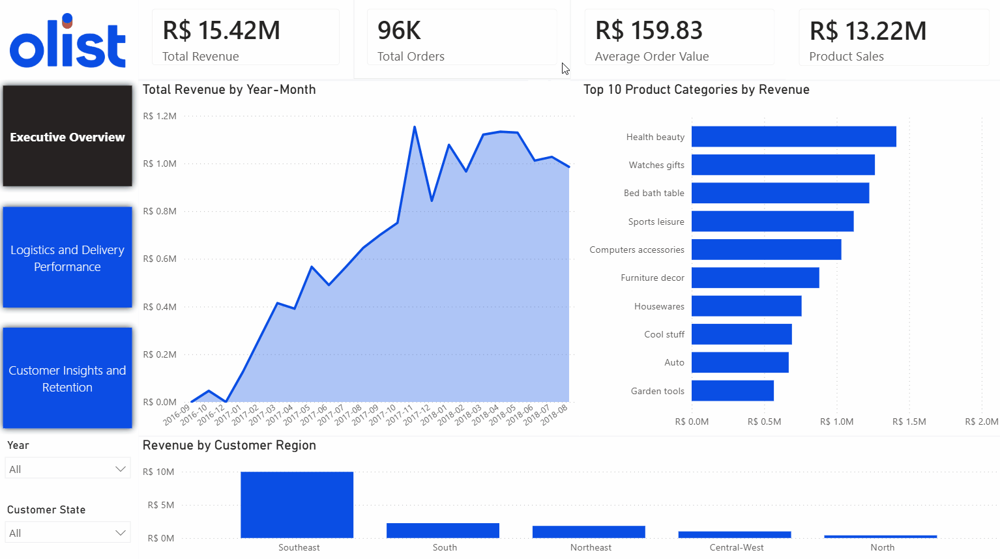
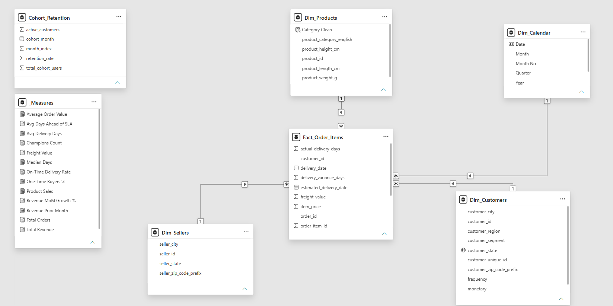
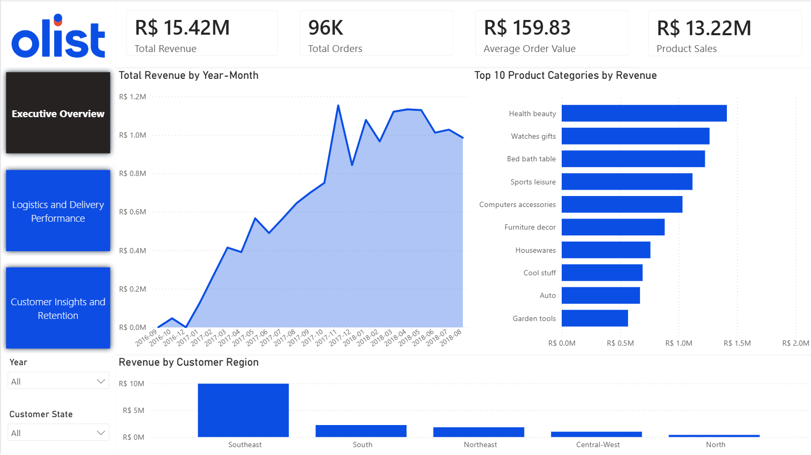
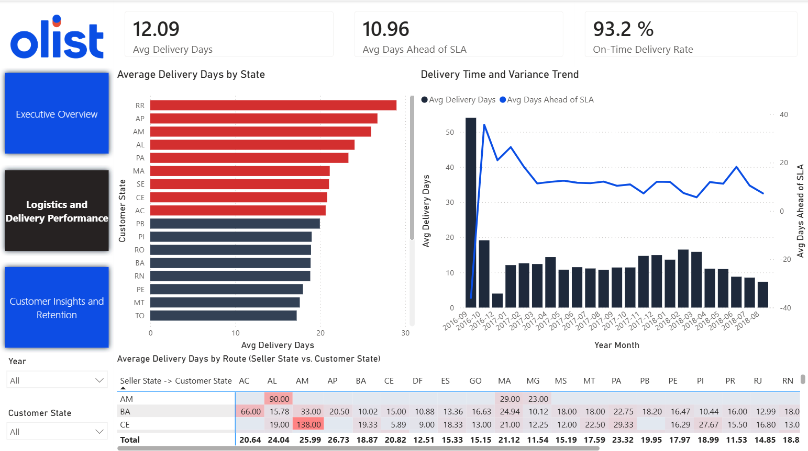
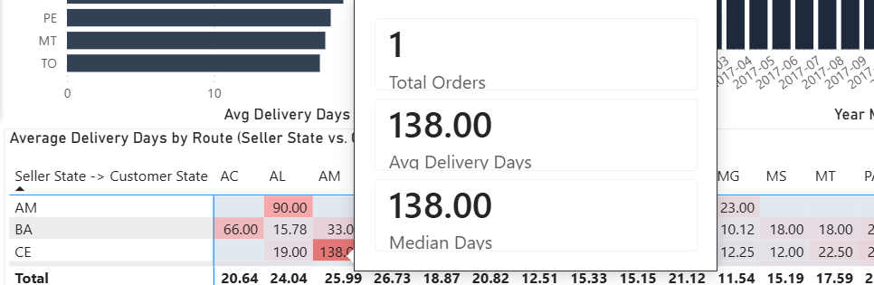
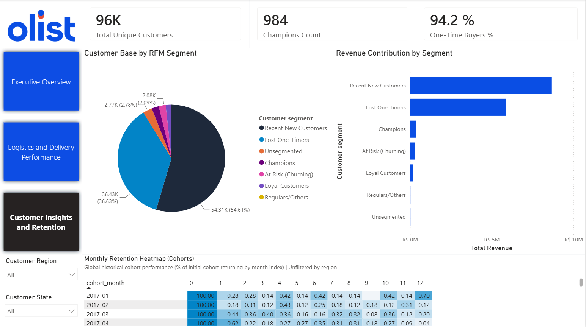

# E-Commerce Sales, Logistics & Customer Retention Analytics (Olist)


## 1. Executive Summary & Business Problem
**Olist** is the largest department store marketplace in Brazil, connecting small businesses from all over the country to customers through a unified platform. 

Following rapid expansion across 2016–2018, executive leadership needed an end-to-end analytical solution to evaluate three core operational pillars:
1. **Commercial Growth & Regional Concentration:** How are revenue and order volume scaling across Brazilian macro-regions and product categories?
2. **Logistics & Carrier SLA Efficiency:** Where are the cross-state delivery bottlenecks across Brazil's continental geography, and are estimated delivery dates (SLAs) well-calibrated?
3. **Customer Lifetime Value & Retention:** What proportion of buyers return for repeat purchases, and how is revenue distributed across behavioral RFM segments?

This repository contains the complete data engineering and business intelligence pipeline—from raw relational data cleaning and analytical SQL modeling in **PostgreSQL** to an interactive, multi-page executive dashboard in **Power BI**.

### Interactive Dashboard Demo


---

## 2. Data Architecture & Technical Decisions

To simulate an enterprise-grade BI environment, the project follows a layered architecture balancing **database pushdown computation (SQL)** with **dynamic semantic modeling (DAX)**:

### A. Kimball Star Schema Design
Raw transactional tables from Olist were cleaned, standardized, and reshaped into an analytical schema (`analytics`) exposed through dedicated Power BI views:
* **Fact Table (`Fact_Order_Items`):** Operates at the **order-item grain** (`order_id` + `order_item_id`), capturing item price, freight value, and order-level delivery timestamps.
* **Dimension Tables (`Dim_Customers`, `Dim_Products`, `Dim_Sellers`, `Dim_Calendar`):** Standardized dimensions connected via one-to-many ($1:*$), single-direction relationships to prevent ambiguous filter propagation.
* **Centralized Measure Table (`_Measures`):** Dedicated DAX calculation table organized into structured display folders (`01. Financials`, `02. Logistics`, `03. Time Intelligence`).



### B. Key Architectural Engineering Highlights
1. **SQL Pushdown Computation vs. DAX Interactivity:**
   * **RFM Segmentation (`vw_rfm_segmentation`)** and **Monthly Cohort Retention (`vw_cohort_retention`)** require multi-pass window functions and historical self-joins across ~100k customers. Computing these in PostgreSQL rather than DAX calculated columns reduces Power BI memory footprint and refresh overhead.
   * `Cohort_Retention` is intentionally loaded as a **disconnected aggregate table** in the semantic model to guarantee accurate global retention baselines across the 12-month horizon without distortion from regional slice contexts.
2. **Eliminating Granularity Bias in Logistics DAX Measures:**
   * Because `Fact_Order_Items` is at the item grain while delivery timestamps exist at the order grain, a naive `AVERAGE(Fact_Order_Items[actual_delivery_days])` artificially weights multi-item orders more heavily.
   * All order-level duration metrics enforce de-duplication at the `order_id` grain using DAX iterators:
     ```dax
     Avg Delivery Days = 
     AVERAGEX(
         VALUES(Fact_Order_Items[order_id]),
         CALCULATE(MAX(Fact_Order_Items[actual_delivery_days]))
     )
     ```
3. **Statistical Robustness in Route Analysis (Report Page Tooltips):**
   * Cross-state logistics distributions are heavily right-skewed due to isolated fulfillment outliers. Custom **Report Page Tooltips** expose both `Avg Delivery Days`, `Median Days`, and `Total Orders` on hover, enabling analysts to distinguish structural bottlenecks from single-order anomalies.

---

## 3. Dashboard Overview & Key Business Findings

### Page 1: Executive Overview (Commercial Performance)


* **Revenue Scale:** Olist generated **R$ 15.42M in Total Revenue** (**R$ 13.22M in net product sales** plus freight) across **~96K orders**, maintaining a healthy **Average Order Value (AOV) of R$ 159.83**.
* **Growth Trajectory:** Monthly revenue scaled rapidly throughout 2017—peaking during the **November 2017 Black Friday** surge at over **R$ 1.15M**—before stabilizing around **R$ 1.0M/month** in H1 2018.
* **Geographic Concentration:** The **Southeast macro-region** (`SP`, `RJ`, `MG`, `ES`) drives approximately **65% of total revenue (~R$ 10M)**, followed by the **South** and **Northeast** regions. Hovering over any macro-region triggers an interactive **State Breakdown Tooltip** for granular drill-down.
* **Category Leadership:** Revenue is well-diversified across core lifestyle categories, led by *Health & Beauty*, *Watches & Gifts*, *Bed Bath & Table*, *Sports & Leisure*, and *Computers & Accessories*.

---

### Page 2: Logistics & Delivery Performance


* **SLA Buffer Paradox:** While the nationwide **Average Delivery Time is 12.09 days** and the **On-Time Delivery Rate reaches 93.2%**, deliveries arrive an average of **10.96 days ahead of the estimated SLA**. This indicates overly conservative delivery estimates that may hurt checkout conversion rates.
* **Regional Bottlenecks (>20 Days Threshold):** Deliveries to remote **North** (`RR`, `AP`, `AM`, `PA`, `AC`) and **Northeast** (`AL`, `MA`, `SE`, `CE`) states average **over 20 days** (highlighted in red), nearly double the national average due to infrastructure distance from Southeast sellers.
* **Origin-Destination Matrix & Outlier Verification:** 
  
  Cross-referencing `seller_state` vs. `customer_state` reveals extreme averages such as **CE $\rightarrow$ AM (138.00 days)** and **AM $\rightarrow$ AL (90.00 days)**. By inspecting our custom tooltip (`Total Orders`, `Avg Delivery Days`, `Median Days`), we verify these are isolated single-order outliers ($N=1$) rather than systemic route failures, whereas high-volume routes like **BA $\rightarrow$ CE** ($N=14$) show a **15.00-day mean** against a **10.50-day median**.

---

### Page 3: Customer Insights & Retention (RFM & Cohorts)


* **The Marketplace Retention Challenge:** Out of **~96K unique customers**, **94.2% are One-Time Buyers**, leaving only **984 Customers in the "Champions" RFM segment**.
* **Revenue Contribution by Segment:** Consequently, revenue is overwhelmingly dependent on continuous customer acquisition (*Recent New Customers* and *Lost One-Timers*), with repeat *Champions* and *Loyal Customers* representing a small fraction of total GMV.
* **Monthly Cohort Heatmap:** Across the 12-month post-purchase window (`month_index` 1 to 12), monthly cohort repeat rates consistently hover between **0.10% and 0.70%**. 
* **Strategic Recommendation:** Implementing post-purchase CRM lifecycle campaigns (e.g., 30-day replenishment vouchers in high-repeat categories like *Health & Beauty*) and tightening SLA estimates in the Southeast/South regions represent the highest-ROI levers to lift repeat purchase rates from ~3% toward industry benchmarks.

---

## 4. Repository Structure

```plaintext
ecommerce-sales-analytics-sql-powerbi/
│
├── data/
│   └── README.md                    # Instructions and official link to the Kaggle dataset
│
├── sql/
│   ├── 01_schema_setup.sql          # Base table DDL, primary/foreign keys, and indexing
│   ├── 02_data_cleaning.sql         # Null handling, deduplication, and type casting views
│   ├── 03_rfm_segmentation.sql      # Customer-grain RFM scoring and behavioral classification
│   ├── 04_cohort_analysis.sql       # Monthly cohort retention matrix calculation
│   └── 05_views_for_powerbi.sql     # Final Kimball Star Schema views (Fact & Dimensions)
│
├── power_bi/
│   ├── ecommerce_dashboard.pbix     # Main Power BI Desktop report and semantic model
│   ├── dax_measures.md              # Catalog and documentation of key DAX measures
│   └── theme.json                   # Custom corporate color palette and visual theme
│
├── documentation/
│   ├── data_dictionary.md           # Schema definitions and table/column descriptions
│   └── star_schema_diagram.png      # Relational Star Schema diagram in Power BI
│
├── assets/                          # Screenshots and interactive GIFs for README
│   ├── dashboard_demo.gif           # End-to-end interactive dashboard walkthrough
│   ├── page1_executive_overview.png # Screenshot: Page 1 - Executive Overview
│   ├── page2_logistics_performance.png # Screenshot: Page 2 - Logistics Performance
│   ├── page3_customer_retention.png # Screenshot: Page 3 - Customer Insights & Retention
│   └── tooltip_logistics.png        # Screenshot: Custom Report Page Tooltip in action
│
└── README.md                        # Project overview, architecture, and business insights
```

## 5. How to Replicate This Project

1. **Database Setup:**
   * Download the raw CSV files from the Kaggle link provided in `data/README.md`.
   * Create a local PostgreSQL database named `olist_database` and execute the scripts inside `sql/` sequentially from `01_schema_setup.sql` to `05_views_for_powerbi.sql`.
   * Execute the scripts inside the `sql/` directory sequentially from `01_schema_setup.sql` to `05_views_for_powerbi.sql` to populate the `analytics` schema.

2. **Power BI Report:**
   * Open `power_bi/ecommerce_dashboard.pbix` in Power BI Desktop.
   * To refresh against your local database, go to **Transform data** $\rightarrow$ **Data source settings**, point the PostgreSQL connection to `localhost:5432` (`olist_database`), and click **Refresh**.